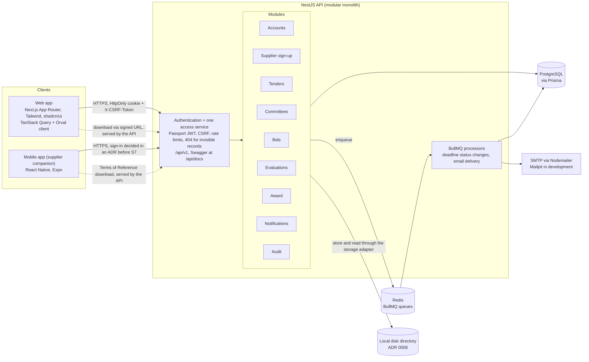

# Architecture (V1)

Status: accepted.

The high-level structure of the platform, following [ADR 0004](ADR/0004_TECHNOLOGY_STACK.md) and [engineering standards §1](../04_RULES/ENGINEERING_STANDARDS.md#1-architecture-and-design-principles). Terms follow the [glossary](../GLOSSARY.md).

## Diagram

## Boundaries

| Part | Responsibility | Talks to |
|---|---|---|
| Web app | Every V1 screen for guests, suppliers, staff, and committees. English and Arabic with right-to-left layout. | The API authorizes access, signs the URL, and serves the file. Never decides access; `allowedActions` only shows or hides controls. |
| Mobile app | Supplier companion: browse tenders, tender detail with countdowns, sign-in, My bids ([V1 scope](../03_SCOPE/V1_SCOPE.md#mobile-app-react-native-s7-supplier-companion)). | The same API, including signed file URLs. Never downloads sealed bid documents. |
| API | All business rules, permissions, and deadlines, by server time. | PostgreSQL, Redis, the local file directory. |
| Modules | One business domain each ([standards §1.1](../04_RULES/ENGINEERING_STANDARDS.md#11-modular-monolith)). | Each other only through public services. No module reads another's tables directly. |
| Access service | Decides who sees which tender, bid, and bid part. Committee views select only their allowed fields. | Every module that returns tender, bid, or evaluation data. |
| BullMQ processors | Status changes at each deadline, email delivery. Retry-safe. | Redis, PostgreSQL, SMTP. |
| PostgreSQL | The [ERD](ERD.md). | — |
| File storage | Uploaded files under random server-generated keys, in a private local directory ([ADR 0006](ADR/0006_LOCAL_DISK_FILE_STORAGE.md)). | The API only, through the storage adapter. Clients receive files through short-lived signed URLs the API serves. |
| SMTP | Account setup, award, cancellation, and Contact Supplier emails. | — |

## Main data flows

- **Request:** client → authentication → access service → module service → Prisma → response DTO for that audience ([standards §2.7](../04_RULES/ENGINEERING_STANDARDS.md#27-dtos)).
- **Deadline:** a scheduled job changes the tender status only from the expected current status (`published` → `closed` or `cancelled`, `closed` → `under_evaluation`).
- **Email:** a module writes an `EMAIL_MESSAGE` and enqueues it. The processor delivers it and records `sent` once the provider confirms acceptance, or `failed` on confirmed non-delivery. If the outcome is uncertain, the message stays `sending` until it is reconciled ([ERD](ERD.md#emails)).
- **Client code:** the API's Swagger document generates the web app's Orval client at build time.
