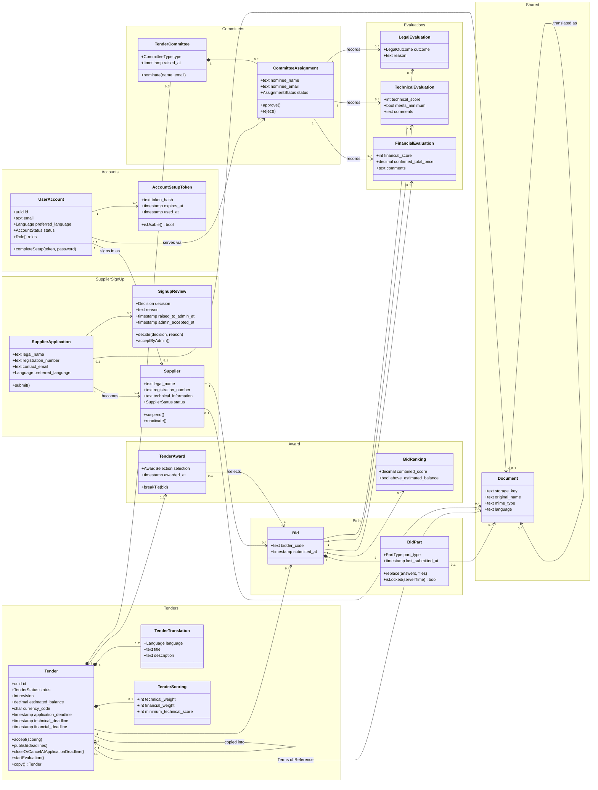
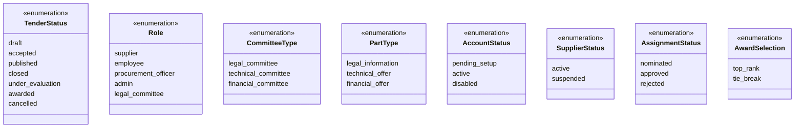
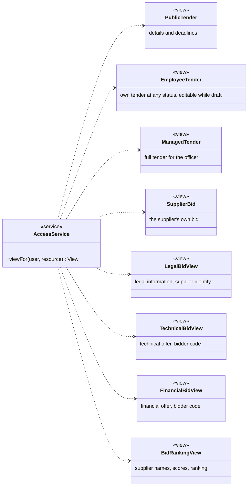

# Class Diagram (V1)

Status: accepted.

The domain classes of the back-end modules ([standards §1.1](../04_RULES/ENGINEERING_STANDARDS.md#11-modular-monolith)). Attributes come from the [ERD](ERD.md), which holds every column, key, and constraint. Operations are the actions in [WORKFLOWS.md](../01_PROBLEM/WORKFLOWS.md). Their final method names are chosen in P2.

Link tables (`USER_ROLE`, the document link tables), form fields, emails, and the supporting tables are left out for readability.

## Domain classes

Each document has exactly one owner: an application, a supplier, a tender, or a bid part ([ERD](ERD.md#document-ownership)). `UserAccount.roles` is derived from `USER_ROLE`.

## Enumerations

`Language` is `en | ar`, `Decision` is `accepted | rejected`, and `LegalOutcome` is `pass | fail`.

## Access service and response views

Every read of a tender, bid, or evaluation goes through one access service, which picks the response view for the caller's audience ([ADR 0004](ADR/0004_TECHNOLOGY_STACK.md), [standards §2.7](../04_RULES/ENGINEERING_STANDARDS.md#27-dtos)). Each view is a separate class, never one class trimmed by conditions.

`TechnicalBidView` and `FinancialBidView` never contain the bid ID, the supplier's identity, original file names, or the other offer. `BidRankingView` never contains bid contents.
