# Entity–Relationship Diagram (V1)

Status: accepted.

The V1 data model, in the terms of the [glossary](../GLOSSARY.md). Processes follow [WORKFLOWS.md](../01_PROBLEM/WORKFLOWS.md), and access follows the [capability matrix](CAPABILITY_MATRIX.md) and [ADR 0002](ADR/0002_INDEPENDENT_TECHNICAL_AND_FINANCIAL_EVALUATION.md). Supplier ratings, contracts, and delivery are postponed and left out.

Columns ending in `_by_user_id` or `_user_id` without a drawn line reference `USER_ACCOUNT`. `AUDIT_EVENT`, `SESSION`, `SESSION_REFRESH_TOKEN`, and `IDEMPOTENCY_KEY` are supporting tables and are not drawn; see [Supporting tables](#supporting-tables).

## Diagram

```mermaid
erDiagram
  USER_ACCOUNT {
    uuid id PK
    text email UK
    text display_name "how the account is shown to staff"
    text password_hash "null until account setup"
    enum preferred_language "en | ar"
    enum status "pending_setup | active | disabled"
    timestamp email_verified_at "set by account setup"
  }
  USER_ROLE {
    uuid user_id PK, FK
    enum role PK "supplier | employee | procurement_officer | admin | legal_committee"
  }
  ACCOUNT_SETUP_TOKEN {
    uuid id PK
    uuid user_id FK
    text token_hash UK
    timestamp expires_at
    timestamp used_at
  }
  SUPPLIER_APPLICATION {
    uuid id PK
    text legal_name
    text registration_number
    text contact_email
    enum preferred_language "UI language when submitted"
    timestamp submitted_at
  }
  SIGNUP_REVIEW {
    uuid id PK
    uuid application_id FK, UK
    uuid reviewer_user_id FK "legal_committee role"
    enum decision "accepted | rejected"
    text reason
    timestamp decided_at
    timestamp raised_to_admin_at "null unless accepted"
    uuid admin_user_id FK
    timestamp admin_accepted_at
  }
  SUPPLIER {
    uuid id PK
    uuid application_id FK, UK
    uuid user_id FK, UK
    text legal_name "current value"
    text registration_number UK "current value"
    text technical_information
    enum status "active | suspended"
  }
  DOCUMENT {
    uuid id PK
    enum owner_type "application | supplier | tender | bid_part"
    text storage_key UK "random, server-generated"
    text original_name "never sent to blind reviewers"
    text mime_type
    int size_bytes
    text language "original language, ISO 639-1"
    uuid translation_of_id FK "null = original"
    uuid uploaded_by_user_id FK "null for guest"
    timestamp uploaded_at
  }
  APPLICATION_DOCUMENT {
    uuid document_id PK, FK
    enum owner_type FK "always application"
    uuid application_id FK
    enum kind
  }
  SUPPLIER_DOCUMENT {
    uuid document_id PK, FK
    enum owner_type FK "always supplier"
    uuid supplier_id FK
    enum kind "registration_certificate | tax_certificate"
  }
  TENDER_DOCUMENT {
    uuid document_id PK, FK
    enum owner_type FK "always tender"
    uuid tender_id FK
    enum kind "terms_of_reference | other"
  }
  BID_PART_DOCUMENT {
    uuid document_id PK, FK
    enum owner_type FK "always bid_part"
    uuid bid_part_id FK
    text kind "standard kind; null for a custom file field"
  }
  TENDER_CATEGORY {
    text code PK "labels live in app translations"
  }
  TENDER {
    uuid id PK
    enum status "draft | accepted | published | closed | under_evaluation | awarded | cancelled"
    int revision "increases on every edit"
    text category_code FK
    uuid requested_by_user_id FK
    decimal estimated_balance
    char currency_code
    timestamp application_deadline
    timestamp technical_deadline
    timestamp financial_deadline
    timestamp accepted_at
    timestamp published_at
    timestamp cancelled_at
    enum cancellation_reason "no_bids | no_qualified_bid"
    uuid copied_from_tender_id FK, UK "null = original"
    timestamp created_at "when the draft was created"
  }
  TENDER_TRANSLATION {
    uuid tender_id PK, FK
    enum language PK "en | ar"
    text title "not null, not empty"
    text description "not null, not empty"
  }
  TENDER_SCORING {
    uuid tender_id PK, FK
    int technical_weight "0-100"
    int financial_weight "0-100, sum = 100"
    int minimum_technical_score "0-100"
  }
  TENDER_COMMITTEE {
    uuid id PK
    uuid tender_id FK
    enum type "legal_committee | technical_committee | financial_committee"
    timestamp raised_at
  }
  COMMITTEE_ASSIGNMENT {
    uuid id PK
    uuid committee_id FK
    uuid tender_id FK "copied from committee"
    text nominee_name
    text nominee_email
    uuid user_id FK "set on approval"
    enum status "nominated | approved | rejected"
    uuid approved_by_user_id FK "admin who decided"
    timestamp nominated_at
    timestamp decided_at
  }
  BID {
    uuid id PK
    uuid tender_id FK
    uuid supplier_id FK
    text bidder_code "system, random, unique per tender"
    timestamp submitted_at
  }
  TENDER_FORM_FIELD {
    uuid id PK
    uuid tender_id FK
    enum part_type
    enum input_type "text | number | boolean | file"
    int position
    bool required
    text unit "optional for numbers"
    decimal minimum "optional for numbers"
  }
  TENDER_FORM_FIELD_TRANSLATION {
    uuid field_id PK, FK
    enum language PK "en | ar"
    text label
    text instructions "optional"
  }
  BID_FIELD_ANSWER {
    uuid bid_part_id PK, FK
    uuid field_id PK, FK
    json scalar_value "typed scalar, null for files"
    uuid document_id FK "optional original bid part document"
  }
  BID_PART {
    uuid id PK
    uuid bid_id FK
    enum part_type "legal_information | technical_offer | financial_offer"
    json standard_answers "standard field values, such as authorizedSignatoryName"
    timestamp last_submitted_at
  }
  LEGAL_EVALUATION {
    uuid bid_id PK, FK
    uuid assignment_id FK
    enum outcome "pass | fail"
    text reason "required when fail"
    timestamp submitted_at
  }
  TECHNICAL_EVALUATION {
    uuid bid_id PK, FK
    uuid assignment_id FK
    int technical_score "entered, 0-100"
    bool meets_minimum "system"
    text comments
    timestamp submitted_at
  }
  FINANCIAL_EVALUATION {
    uuid bid_id PK, FK
    uuid assignment_id FK
    int financial_score "entered, 0-100"
    decimal confirmed_total_price "entered, in tender currency"
    text comments
    timestamp submitted_at
  }
  BID_RANKING {
    uuid bid_id PK, FK
    uuid tender_id FK
    decimal combined_score "system, numeric(5,2)"
    bool above_estimated_balance "system"
    timestamp calculated_at
  }
  TENDER_AWARD {
    uuid tender_id PK, FK
    uuid winning_bid_id FK, UK
    enum selection "top_rank | tie_break"
    uuid tie_broken_by_user_id FK "procurement_officer, tie only"
    timestamp awarded_at
  }
  EMAIL_MESSAGE {
    uuid id PK
    enum kind "account_setup | award_winner | award_other | cancellation | contact_supplier"
    uuid recipient_user_id FK
    text recipient_email "snapshot"
    enum language "en | ar, snapshot"
    text subject
    text body
    uuid tender_id FK
    enum status "draft | sending | sent | failed"
    int revision "increases on every edit"
    text failure_code "set when failed"
    timestamp failed_at "set when failed"
    uuid sent_by_user_id FK "null when automatic"
    timestamp prepared_at
    timestamp sent_at
  }

  USER_ACCOUNT ||--o{ USER_ROLE : holds
  USER_ACCOUNT ||--o{ ACCOUNT_SETUP_TOKEN : "sets up with"
  USER_ACCOUNT ||--o| SUPPLIER : "signs in as"
  USER_ACCOUNT ||--o{ SIGNUP_REVIEW : reviews
  SUPPLIER_APPLICATION ||--o| SIGNUP_REVIEW : "reviewed in"
  SUPPLIER_APPLICATION ||--o| SUPPLIER : becomes
  SUPPLIER_APPLICATION ||--o{ APPLICATION_DOCUMENT : attaches
  SUPPLIER ||--o{ SUPPLIER_DOCUMENT : keeps
  DOCUMENT ||--o| APPLICATION_DOCUMENT : "filed as"
  DOCUMENT ||--o| SUPPLIER_DOCUMENT : "filed as"
  DOCUMENT ||--o| TENDER_DOCUMENT : "filed as"
  DOCUMENT ||--o| BID_PART_DOCUMENT : "filed as"
  DOCUMENT |o--o{ DOCUMENT : "translated as"
  TENDER_CATEGORY ||--o{ TENDER : classifies
  USER_ACCOUNT ||--o{ TENDER : requests
  TENDER ||--|{ TENDER_TRANSLATION : "written in"
  TENDER ||--o{ TENDER_DOCUMENT : attaches
  TENDER ||--o| TENDER_SCORING : "scored by"
  TENDER |o--o| TENDER : "copied into"
  TENDER ||--o{ TENDER_COMMITTEE : raises
  TENDER_COMMITTEE ||--o{ COMMITTEE_ASSIGNMENT : staffs
  USER_ACCOUNT |o--o{ COMMITTEE_ASSIGNMENT : "serves via"
  TENDER ||--o{ BID : receives
  SUPPLIER ||--o{ BID : submits
  BID ||--|{ BID_PART : "made of (exactly 3)"
  TENDER ||--o{ TENDER_FORM_FIELD : defines
  TENDER_FORM_FIELD ||--|{ TENDER_FORM_FIELD_TRANSLATION : labels
  TENDER_FORM_FIELD ||--o{ BID_FIELD_ANSWER : receives
  BID_PART ||--o{ BID_FIELD_ANSWER : contains
  BID_PART_DOCUMENT |o--o| BID_FIELD_ANSWER : supplies
  BID_PART ||--o{ BID_PART_DOCUMENT : contains
  BID ||--o| LEGAL_EVALUATION : "legally evaluated"
  BID ||--o| TECHNICAL_EVALUATION : "technically evaluated"
  BID ||--o| FINANCIAL_EVALUATION : "financially evaluated"
  COMMITTEE_ASSIGNMENT ||--o{ LEGAL_EVALUATION : records
  COMMITTEE_ASSIGNMENT ||--o{ TECHNICAL_EVALUATION : records
  COMMITTEE_ASSIGNMENT ||--o{ FINANCIAL_EVALUATION : records
  BID ||--o| BID_RANKING : "ranked as"
  TENDER ||--o| TENDER_AWARD : "awarded by"
  BID ||--o| TENDER_AWARD : wins
  USER_ACCOUNT ||--o{ EMAIL_MESSAGE : receives
  TENDER |o--o{ EMAIL_MESSAGE : concerns
```

## Decisions applied

| Decision | Effect on the model |
|---|---|
| Tender committee access is per tender. | Committee access to a tender comes only from an approved `COMMITTEE_ASSIGNMENT`. `TENDER_COMMITTEE.type` uses the glossary role names. |
| Sign-up review is a standing `legal_committee` duty. | `USER_ROLE` value `legal_committee` allows reviewing `SUPPLIER_APPLICATION`s only. It gives no tender access. |
| The `admin` only accepts the request raised by the `legal_committee`. | Acceptance creates `USER_ACCOUNT` (`pending_setup`, no password) and `SUPPLIER`, and sends an `account_setup` email automatically. |
| The supplier sets a password through the emailed link. | Using the single-use `ACCOUNT_SETUP_TOKEN` sets the password, `email_verified_at`, and status `active`. The supplier is then signed up. |
| One shared technical score per bid. | `TECHNICAL_EVALUATION` is keyed on `bid_id`. |
| The `financial_committee` gives the financial score. | It enters `financial_score` and, separately, `confirmed_total_price` for the above-balance flag. |
| The system chooses the top-ranked bid. | `TENDER_AWARD.selection = top_rank`. Bids tied at the top share the rank, and the `procurement_officer` chooses among them (`tie_break`). |
| One committee per person per tender. | Unique (`tender_id`, `user_id`) on `COMMITTEE_ASSIGNMENT`. |
| The bid form requires all three bid parts, and every field and file marked required. | A bid is created with all three bid parts. The `legal_committee` fails a bid whose legal information is not qualified. |
| Suppliers have their own status. | `SUPPLIER.status`: `active` or `suspended`. The `admin` suspends or reactivates a supplier at their discretion. |
| Supplier ratings are postponed. | Not in V1. See [Extension](#extension). |
| Concurrent edits and retries are safe (approved with the [API contract](API_CONTRACT.md)). | `TENDER.revision`, `EMAIL_MESSAGE.revision` and status `sending`, and the `SESSION`, `SESSION_REFRESH_TOKEN`, and `IDEMPOTENCY_KEY` supporting tables. |
| New committee members use the account setup link. | Approving a nominee without an account creates a `pending_setup` account in the language the `admin` chooses, with an `account_setup` email. |

## Distinctions the model keeps

| Distinction | How |
|---|---|
| Reusable supplier profile vs sign-up review | `SUPPLIER_APPLICATION` + `SIGNUP_REVIEW` record the one-time sign-up and never change after review. `SUPPLIER` is the current profile and the source of truth from then on. |
| Profile vs bid and Legal Evaluation | A `BID` and its `legal_information` part hold the tender-specific legal information. `LEGAL_EVALUATION` belongs to the bid. |
| Committee assignment vs evaluation | `TENDER_COMMITTEE` + `COMMITTEE_ASSIGNMENT` put a person on one tender's committee. Evaluations reference the assignment that recorded them. |
| Supplier identity vs bidder code | Technical and financial views use (`tender_id`, `bidder_code`), never `BID.id` or `BID.supplier_id`. |
| Scoring settings vs results | Settings in `TENDER_SCORING`. Values people enter in the evaluation tables. Values the system calculates in `BID_RANKING` and `TENDER_AWARD`. |
| Cancelled tender vs its copy | `TENDER.copied_from_tender_id` links the copy to its source. Bids, committees, and deadlines stay with the source. |

## Constraints the diagram does not show

### Language

- `USER_ACCOUNT.preferred_language` drives the web and mobile interface, including right-to-left layout for Arabic. Interface labels and category labels live in application translations.
- A `TENDER_TRANSLATION` row exists only when complete: title and description are both non-empty. A tender has at least one row. A reader sees their preferred language, or the other row when it is missing.
- **Email language:** `EMAIL_MESSAGE.language` is the recipient's `preferred_language` when the email is prepared, and is fixed for that message. A supplier account starts with `SUPPLIER_APPLICATION.preferred_language`. Staff accounts start with the language chosen at account creation. Users can change it later.
- A translated `DOCUMENT` points to its original through `translation_of_id`:
  - An original has no `translation_of_id`. A translation must reference an original directly.
  - Unique (`translation_of_id`, `language`), and the language differs from the original's.
  - A translation has the same owner as its original.
  - Replacing or deleting an original deletes its translations.

### Document ownership

- Each link table carries a fixed `owner_type` and references a unique `DOCUMENT(id, owner_type)` pair. This prevents links to multiple owner types. Require exactly one owner link at transaction commit, including when a document is created or its link is removed.
- `storage_key` is random and contains no supplier or tender data.
- Blind reviewers never receive `original_name` or `uploaded_by_user_id`. Files are downloaded under neutral names through short-lived signed URLs.
- Identifying content inside a file, such as a letterhead or file metadata, cannot be prevented by the model. The bid form instructs suppliers not to identify themselves in technical and financial files.

### Sealed, blind evaluation (enforced by the access service)

| Audience | Reads | Never reads |
|---|---|---|
| `legal_committee` (sign-up) | `SUPPLIER_APPLICATION` and its documents | Tenders, bids |
| `legal_committee` assignment | The bid's legal information and documents, supplier identity | Technical and financial offers, other evaluations |
| `technical_committee` assignment | (`tender_id`, `bidder_code`), the technical offer and documents, for bids with `LEGAL_EVALUATION.outcome = pass` | `SUPPLIER`, `BID.id`, financial offers, `FINANCIAL_EVALUATION`, `TENDER_SCORING`, `BID_RANKING`, `estimated_balance` |
| `financial_committee` assignment | (`tender_id`, `bidder_code`), the financial offer and documents, for bids with `meets_minimum = true` | `SUPPLIER`, `BID.id`, technical offers, `technical_score`, `TENDER_SCORING`, `BID_RANKING`, `estimated_balance` |
| `procurement_officer` | `BID_RANKING` with supplier names and scores, `TENDER_AWARD` | `BID_PART` and its documents |

- A committee reviewer sees a tender’s bids only through an approved assignment of the matching type on that tender. Anything else returns 404.
- An evaluation's assignment is approved and belongs to the bid's tender and the matching committee type. The evaluation transaction checks this.
- One evaluation per committee per bid (`bid_id` is the key). Evaluations are insert-only.

### Committees

- `TENDER_COMMITTEE` is unique on (`tender_id`, `type`).
- `COMMITTEE_ASSIGNMENT.tender_id` matches its committee: composite foreign key (`committee_id`, `tender_id`) to the unique `TENDER_COMMITTEE(id, tender_id)` pair.
- Unique (`tender_id`, `user_id`) on `COMMITTEE_ASSIGNMENT`: one committee per person per tender.
- The tender's requesting `employee`, and any `procurement_officer` or `admin`, are never assigned to that tender's committees. The approval checks this.
- The `procurement_officer` nominates members by name and email. The `admin` approves them and creates or links their accounts.
- When the nominee has no account, approval creates a `USER_ACCOUNT` (`pending_setup`, no password, no `USER_ROLE`, `display_name` = `nominee_name`) in the `preferred_language` the `admin` chooses, its first `ACCOUNT_SETUP_TOKEN`, and an `account_setup` email, in one transaction with the approval. Setting a password activates the account.
- When the nominee already has an account, approval links it to the assignment. No token or email is created.

### Sign-up

- `SIGNUP_REVIEW.reviewer_user_id` holds the `legal_committee` role.
- `raised_to_admin_at` is set only when `decision = accepted`. `admin_accepted_at` is set only after `raised_to_admin_at`.
- `SUPPLIER`, its `USER_ACCOUNT` (`display_name` = `legal_name`), the first `ACCOUNT_SETUP_TOKEN`, and the `account_setup` email are created in one transaction with the admin's acceptance.
- `ACCOUNT_SETUP_TOKEN` is stored hashed, expires 48 hours after it is issued, and is single-use. A new token can be issued if one expires.
- A sign-up whose contact email already belongs to a `USER_ACCOUNT` is refused at submission and again at the admin's acceptance.
- The admin's acceptance provisions at most once. A registration number that another `SUPPLIER` already has refuses the acceptance, and the request stays raised.
- The supplier may change the legal fields of `SUPPLIER` (`legal_name`, `registration_number`). `SUPPLIER_APPLICATION` keeps the values the `legal_committee` reviewed. A new `legal_name` also becomes the account's `display_name`.
- The supplier may replace a sign-up certificate. The new file is a `SUPPLIER_DOCUMENT` of the same kind, and a supplier has at most one per certificate kind; a replacement removes the previous one. The `APPLICATION_DOCUMENT` the `legal_committee` reviewed is never changed. Until replaced, the profile shows the reviewed file.

### Bids

- `BID` is unique on (`tender_id`, `supplier_id`), on (`tender_id`, `bidder_code`), and on (`id`, `tender_id`) for composite foreign keys.
- A bid is created with all three `BID_PART`s, each with its required files, in one transaction, before the application deadline. `BID_PART` is unique on (`bid_id`, `part_type`).
- A part can be replaced only before its own deadline, by server time. Replacing overwrites the row and deletes its documents. Earlier versions are not kept.
- Only an `active` supplier can submit a bid.
- `BID_PART.standard_answers` holds the values of the standard bid form fields of that part; custom fields use `BID_FIELD_ANSWER`. `BID_PART_DOCUMENT.kind` names the standard document a file supplies; a custom file field's file has no kind and is linked through `BID_FIELD_ANSWER.document_id`.

### Lifecycle jobs

- Each status change updates only from the expected current status, so a retried job does nothing.
- Bid creation and the application-deadline job both lock the tender row, so a last-second bid cannot be missed when deciding between `closed` and `cancelled`.
- Lock order: the tender row first, then the supplier, bid part or committee assignment row. Bids and committee staffing take a share lock on the tender; the deadline job and evaluations take an exclusive one, so a status change never interleaves with them.
- An evaluation stage is complete when the stage before it is complete and every bid eligible for it has an evaluation row (Legal: every bid). The check runs inside each evaluation transaction, which locks the tender row. If a complete stage leaves no eligible bid, the tender becomes `cancelled` with `no_qualified_bid`.
- The deadline job runs every minute: `published` → `closed` (or `cancelled` with `no_bids`) at the application deadline, and `closed` → `under_evaluation` at the financial deadline.

### Scoring and award

| | Values |
|---|---|
| Entered at accept (`procurement_officer`) | `TENDER_SCORING` |
| Entered by the `employee` | `estimated_balance` |
| Entered at publish (`procurement_officer`) | The three deadlines, in the order application → technical → financial |
| Locked from publish | `TENDER_SCORING`, deadlines, `estimated_balance`, category, translations, Terms of Reference, form fields |
| Entered by committees | Legal outcome, technical score, financial score, confirmed total bid price |
| Calculated by the system | `bidder_code`, `meets_minimum`, status changes, `cancellation_reason`, `combined_score`, `above_estimated_balance`, the top-ranked winner |

- CHECKs: every score and weight is 0–100, and `technical_weight + financial_weight = 100`.
- `combined_score = (technical_weight × technical_score + financial_weight × financial_score) / 100`, stored as `numeric(5,2)`. Rank is calculated on read, highest first. Equal scores share a rank.
- `BID_RANKING` references `BID(id, tender_id)`.
- When the Financial Evaluation is complete, the system writes `BID_RANKING`. If one bid has the highest score, the system writes `TENDER_AWARD` (`top_rank`) and sets `awarded` in the same transaction. If several bids share the highest score, the `procurement_officer` chooses one of them (`tie_break`).
- `TENDER_AWARD` references `BID(id, tender_id)` through (`winning_bid_id`, `tender_id`), and the winner has a `BID_RANKING` row with the highest `combined_score`.
- The above-balance flag is informational. It does not stop a bid from winning.

### Emails

- `account_setup` emails are sent automatically. Award and cancellation emails are prepared as drafts that the `procurement_officer` reviews and sends.
- Partial unique index on (`tender_id`, `recipient_user_id`, `kind`) for `award_winner`, `award_other`, and `cancellation`, so retries never prepare a duplicate. `contact_supplier` can repeat.
- Status changes: `draft` → `sending` → `sent` or `failed`, and `failed` → `sending` on a retry. Any other change is rejected.
- Every edit increases `revision`. Edits are allowed only while `draft` or `failed`.
- An officer-initiated send claims the reviewed revision by atomically changing a matching row from `draft` or `failed` to `sending`. Only the successful claim schedules delivery. Automatic `account_setup` emails start at `sending` when created.
- Identify each delivery by message ID and revision. If provider acceptance is uncertain, keep the message at `sending`. Recover using the same identifier within the provider's deduplication window, or confirm the outcome with the provider before retrying. Record confirmed acceptance as `sent`. Only confirmed non-delivery may become `failed`.
- On failure, record `failure_code` and `failed_at` for the API's `failure.code` and `failure.at`. Clear both when a retry claims the message.

### Copying a cancelled tender

- The source is `cancelled`. The copy starts at `accepted`.
- Copied: category, requesting employee, `estimated_balance` and currency, translations, `TENDER_SCORING` (editable until the copy is published), and Terms of Reference. Each Terms of Reference file is copied to a new storage object, with a new `DOCUMENT` row.
- Not copied: deadlines, bids, committees, emails.
- A cancelled tender can be copied at most once (unique `copied_from_tender_id`).

### Supplier bid form

- Each tender starts with the standard bid fields and document requirements. Custom fields supplement them. Order custom fields by position, unique within the tender and part. Each field needs a non-empty label in at least one supported language. Apply tender language fallback per field.
- Only the procurement officer edits the template while the tender is `accepted`. Publication locks it. A cancelled-tender copy receives new field IDs and copies their definitions and translations, excluding answers.
- Store at most one answer per part and field. Validate that tender and part type match the definition. Require every mandatory answer and validate scalar types and any numeric minimum. A file answer references exactly one original document of that bid part, unique among answers. Translations follow the original document. Scalar answers contain only a scalar value.
- Commit answers with their bid part. Replacement overwrites that part’s complete answer set atomically. An evaluation view can read answers and files only for its own part. Technical and financial answers must preserve bidder anonymity.

### Tender revision

- `TENDER.revision` starts at 1 and increases on every change to the tender's content, category, `estimated_balance`, `TENDER_SCORING`, Terms of Reference, or form fields (including labels and order), and on accept and publish. Raising committees and nominating members do not change it.
- An edit names the `revision` it was based on. A mismatch is rejected as a conflict. A status that no longer allows the edit is rejected first, as a status change.

### Supporting tables

| Table | Columns | Rules |
|---|---|---|
| `SESSION` | `id` PK, `user_id` FK, `expires_at`, `revoked_at`, `created_at` | One row per sign-in. Sign-out sets `revoked_at`, and every request checks it. |
| `SESSION_REFRESH_TOKEN` | `token_hash` PK, `session_id` FK, `issued_at`, `replaced_at` | A refresh consumes the current token and issues its successor atomically. Keep replaced hashes until session expiry. Reuse of a replaced token revokes the session. |
| `IDEMPOTENCY_KEY` | `user_id` FK or `guest_scope_id`, `route`, `key`, `payload_hash`, `response_status`, `response_body`, `expires_at` | Exactly one owner. Separate partial unique indexes enforce (owner, route, key) for each owner type. Retain keys for 24 hours. |

A guest’s scope is a server-issued opaque browser identifier established during CSRF bootstrap and stable across retries and CSRF token renewal. Signed-in requests use the authenticated user ID. The route includes the HTTP method and target resource.

Reserve the key and payload hash before acting. A null response status marks an in-progress reservation. A different hash returns 422. A matching retry receives 409 while pending, then the saved status and body after completion. Commit the business change and saved result together. Recover an abandoned reservation only after confirming the original operation can no longer commit.

### Indexes

Primary and unique keys already cover: `USER_ACCOUNT.email`, `SUPPLIER.registration_number`, `BID(tender_id, supplier_id)`, `BID_PART(bid_id, part_type)`, evaluation `bid_id`, `COMMITTEE_ASSIGNMENT(tender_id, user_id)`.

Add:

- `TENDER(status)`, `TENDER(published_at)`, and `TENDER(status, application_deadline)`, `(status, financial_deadline)` for the deadline jobs.
- `TENDER(requested_by_user_id, created_at)` for an employee's "My tenders".
- `SUPPLIER(status)`, `BID(supplier_id)`, `COMMITTEE_ASSIGNMENT(user_id)`, `SIGNUP_REVIEW(reviewer_user_id)`.
- Each evaluation's `assignment_id`, `BID_RANKING(tender_id, combined_score)`.
- Every link-table owner foreign key, and `EMAIL_MESSAGE(tender_id)`.
- `AUDIT_EVENT(resource_type, resource_id, occurred_at)` and `AUDIT_EVENT(occurred_at)`.
- `SESSION(user_id)`, `SESSION_REFRESH_TOKEN(session_id)`, and `IDEMPOTENCY_KEY(expires_at)` for clean-up.

### Extension

A future `SUPPLIER_RATING` references `BID(id)`, the supplier's actual participation in a tender, or `TENDER_AWARD`. Neither changes historical bids or evaluations. `DOCUMENT` is a shared file-storage service used by the domain modules, not a domain module itself.

## Traces

**Supplier sign-up**

1. A `guest` submits `SUPPLIER_APPLICATION` with their legal information and documents.
2. A `legal_committee` reviewer records `SIGNUP_REVIEW` as `accepted`, which raises it to the `admin`.
3. The `admin` accepts. One transaction creates `SUPPLIER` (`active`), `USER_ACCOUNT` (`pending_setup`), an `ACCOUNT_SETUP_TOKEN`, and an `account_setup` email in the applicant's language.
4. The supplier opens the link and sets a password. The account becomes `active` and the email is verified.

**One bid, submission to award**

1. The `supplier` submits the bid form before the application deadline. One transaction creates `BID` (random `bidder_code`) and its three parts with their files. A retry hits the (`tender_id`, `supplier_id`) unique key.
2. The supplier may replace each part until its own deadline.
3. At the financial deadline, a job moves the tender from `closed` to `under_evaluation`.
4. A legal assignment records `LEGAL_EVALUATION` with outcome `pass`.
5. A technical assignment enters 78. With a minimum of 60, the system sets `meets_minimum = true`.
6. A financial assignment enters a financial score and the confirmed total bid price.
7. When the Financial Evaluation is complete, the system writes `BID_RANKING`, flagging prices above `estimated_balance`. This bid has the highest combined score, so the system writes `TENDER_AWARD` (`top_rank`) and sets `awarded`.
8. The platform prepares one award email per bidder in that bidder's language. The `procurement_officer` reviews and sends them.

**One cancelled tender, through copying**

1. Tender T1 is published and receives no bids by the application deadline. The system sets `cancelled` with reason `no_bids`.
2. The `procurement_officer` copies T1. T2 has `copied_from_tender_id = T1`, status `accepted`, no deadlines, copied translations and scoring, and copied Terms of Reference files. It has no bids or committees.
3. The officer edits T2, raises its committees, sets new deadlines, and publishes it. T1 and its history are unchanged.

## Assumptions

- **A1:** a draft tender is a `TENDER` row with status `draft`, without deadlines, scoring, or committees.
- **A2:** tender content, Terms of Reference, `estimated_balance`, and category lock at publication.
- **A3:** each tender has one currency. The `financial_committee` converts the bid's total into it when entering `confirmed_total_price`.
- **A4:** each supplier has one user account. Its email is the verified address used for Contact Supplier.
- **A5:** a cancelled tender is copied at most once. Committees are not copied.
- **A6:** the `procurement_officer` nominates committee members by name and email. The `admin` approves them and creates or links their accounts. A new account is set up through the same account setup link as a supplier's.
- **A7:** categories are a fixed seeded list.
- **A8:** bid documents are uploaded per bid. Reusing a profile document in a bid creates a new `DOCUMENT` row and storage object.
- **A9:** the actors of status changes are recorded in `AUDIT_EVENT`.
- **A10:** document `language` accepts any ISO 639-1 code. Interface and tender content use `en` and `ar` only.
- **A11:** the `financial_committee` scores bids and does not fail them.
- **A12:** the `admin` can accept a raised request but not reject it.
- **A13:** the `legal_committee` fails a bid only on its legal information. It never sees the technical or financial offer, so an unqualified technical or financial file lowers that committee's score instead.
- **A14:** suspension blocks new bids only. A suspended supplier keeps signing in, and its existing bids continue through evaluation.
- **A15:** `display_name` is set when the account is created: from the seed for staff, from `nominee_name` for committee members, and from `legal_name` for suppliers. It is never empty.

## Open items

None. The glossary, workflows, capability matrix, ADR 0001, engineering standards, roadmap, and [V1 scope](../03_SCOPE/V1_SCOPE.md) are aligned with this ERD.
