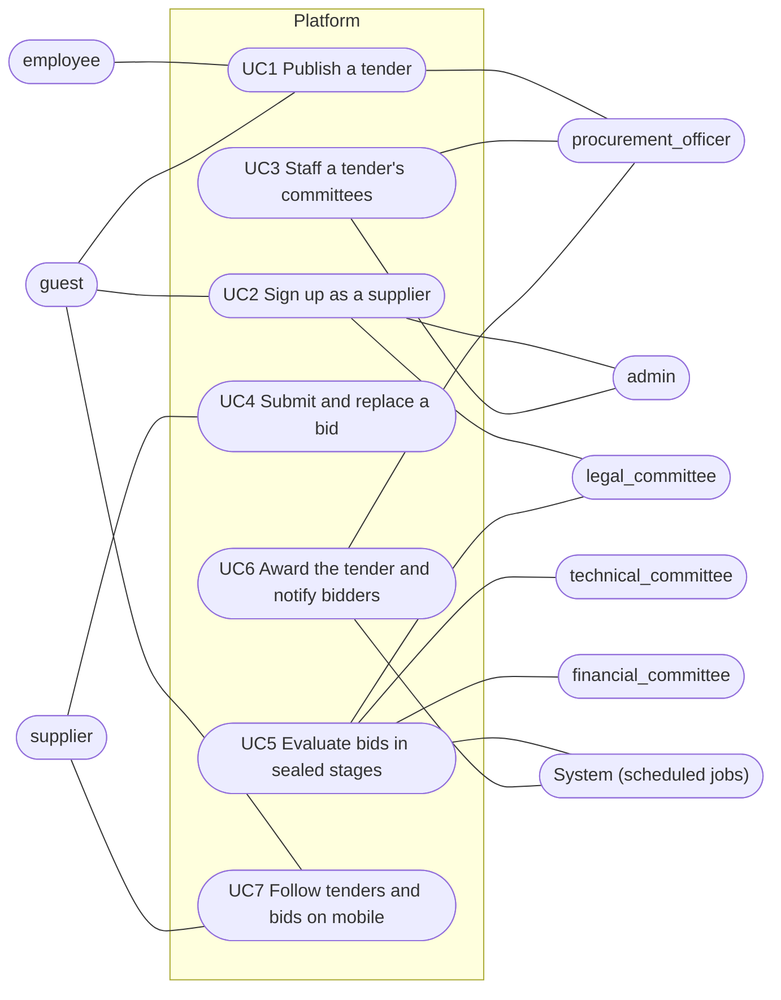

# Use Cases (V1)

Status: accepted.

One use case per V1 slice, in the terms of the [glossary](../GLOSSARY.md). Steps follow [WORKFLOWS.md](../01_PROBLEM/WORKFLOWS.md), and access follows the [capability matrix](CAPABILITY_MATRIX.md).

## Use case diagram

In UC1, the `guest` only sees the published tender. In UC5, the system moves the tender to `under_evaluation` and calculates the ranking.

## UC1 Publish a tender (S1)

- **Actors:** `employee`, `procurement_officer`. The `guest` sees the result.
- **Precondition:** the `employee` and `procurement_officer` are signed in.
- **Main scenario:**
  1. The `employee` creates a **draft tender** with its category, **estimated balance**, and English or Arabic title and description.
  2. The `procurement_officer` accepts it and sets the **score weights** and **minimum technical score**.
  3. The officer uploads the Terms of Reference, adjusts the supplier bid form, and sets the three deadlines.
  4. The officer publishes it. The scoring, deadlines, and content are now locked.
  5. A `guest` sees the tender in their language, or in the other language when no translation exists.
- **Alternatives and failures:**
  - Someone else changed the tender first: `409 VERSION_CONFLICT`, and the user reloads it.
  - The weights do not add up to 100, or the deadlines are not in the order application → technical → financial: the change is rejected.
- **Result:** the tender is `published`. The score weights and estimated balance are never shown to the `guest`.

## UC2 Sign up as a supplier (S2)

- **Actors:** `guest`, `legal_committee` (standing role), `admin`.
- **Main scenario:**
  1. The `guest` fills in the sign-up form with their legal information and documents. Every field is required.
  2. A `legal_committee` member performs the **sign-up review**, accepts it, and raises it to the `admin`.
  3. The `admin` accepts the request without changing it.
  4. The platform creates the supplier account and emails an **account setup link** in the `guest`'s language.
  5. The applicant opens the link and sets a password. They are now a `supplier` and can add technical information.
- **Alternatives and failures:**
  - The `legal_committee` rejects the application: the sign-up ends.
  - The link has expired: the applicant requests a new one.
  - The link was already used: it is refused.
- **Result:** an `active` `supplier` with a verified email address.

## UC3 Staff a tender's committees (S3)

- **Actors:** `procurement_officer`, `admin`.
- **Precondition:** the tender is `accepted`, `published`, or `closed`.
- **Main scenario:**
  1. The `procurement_officer` raises the tender's `legal_committee`, `technical_committee`, and `financial_committee`.
  2. The officer nominates members by name and email.
  3. The `admin` approves each nomination. A nominee without an account receives an **account setup link** in the language the `admin` chooses.
  4. A new member sets a password through the link and lands on My assignments. An existing member sees the assignment when signed in.
- **Alternatives and failures:**
  - The `admin` rejects a nomination: it ends there.
  - The nominee is already on another committee of this tender, or is the tender's requesting `employee`, the `procurement_officer`, or an `admin`: the approval is refused.
- **Result:** each committee has approved **committee assignments** for this tender only.

## UC4 Submit and replace a bid (S4)

- **Actor:** `supplier`.
- **Preconditions:**
  - Submit: the supplier is `active`, and the tender is `published` and before its application deadline.
  - Replace: the supplier owns the bid, and the part's own deadline has not passed. This holds even after the tender is `closed` or the supplier is `suspended`.
- **Main scenario:**
  1. The supplier opens the tender and fills in one form with all three **bid parts**: legal information, technical offer, and financial offer, with every required file.
  2. The platform creates the **bid** and gives it a random **bidder code**.
  3. Before each part's own deadline, the supplier may replace that part. The earlier version is not kept.
- **Alternatives and failures:**
  - The application deadline has passed: the new bid is rejected.
  - A part's deadline has passed: that part is locked.
  - The supplier is `suspended`: a new bid is rejected, but existing parts can still be replaced on time.
  - The supplier retries after a network error: the same idempotency key returns the original result, and no duplicate bid is created.
- **Result:** one bid per supplier per tender, with three parts.

## UC5 Evaluate bids in sealed stages (S5)

- **Actors:** `legal_committee`, `technical_committee`, `financial_committee` (each through a committee assignment on this tender); the system.
- **Precondition:** the financial deadline has passed, and the system has moved the tender to `under_evaluation`.
- **Main scenario:**
  1. **Legal Evaluation:** the `legal_committee` passes or fails each bid on its legal information.
  2. **Technical Evaluation:** the `technical_committee` sees only the passed bids, by bidder code, and gives each a **technical score**. Bids below the **minimum technical score** fail.
  3. **Financial Evaluation:** the `financial_committee` sees only the remaining bids, by bidder code, and enters a **financial score** and the **confirmed total bid price**.
  4. The system calculates each eligible bid's **combined score** and the **ranking**, and flags bids priced above the **estimated balance**.
- **Alternatives and failures:**
  - A completed stage leaves no eligible bid: the tender becomes `cancelled`.
  - A committee member requests a bid of another stage or tender: `404`.
- **Result:** either a complete ranking of the eligible bids, or a `cancelled` tender (`no_qualified_bid`). No committee has seen the supplier's identity in the technical or financial stage, or another stage's offer.

## UC6 Award the tender and notify bidders (S6)

- **Actors:** the system, `procurement_officer`.
- **Precondition:** the ranking is complete, or the tender is `cancelled`.
- **Main scenario:**
  1. One bid has the highest combined score, so the system awards it and the tender becomes `awarded`.
  2. The platform prepares one email per bidder in their language: one for the winner, one for every other bidder.
  3. The `procurement_officer` reviews and edits the emails, then sends them.
- **Alternatives and failures:**
  - Several bids share the top rank: the officer chooses one of them.
  - Confirmed non-delivery: the email shows `failed`, and the officer may retry it. If delivery is uncertain, the email stays `sending` until the platform confirms the outcome.
  - Cancelled after evaluation (`no_qualified_bid`): the platform prepares one cancellation email per bidder, which the officer reviews and sends.
  - Cancelled because no bids arrived (`no_bids`): there are no bidders, so no emails are prepared.
- **Result:** the tender is `awarded` or `cancelled`, and every bidder has an email for the officer to review and send. Bidders who did not win receive no scores or details about the winning bid.

## UC7 Follow tenders and bids on mobile (S7)

- **Actors:** `guest`, `supplier`.
- **Main scenario:**
  1. A `guest` or `supplier` browses and searches published tenders in English or Arabic.
  2. They open a tender, see its deadline countdowns by server time, and download its Terms of Reference.
  3. A `supplier` signs in and opens My bids: each bid's tender status, part deadlines, and which parts are locked.
- **Alternatives and failures:**
  - The supplier wants to submit or replace a bid: they do it on the web.
  - The supplier's device session is no longer valid: the app removes the private bid view and asks the supplier to sign in again.
- **Result:** the supplier can keep track of deadlines without the web app. No sealed bid document reaches the phone.
